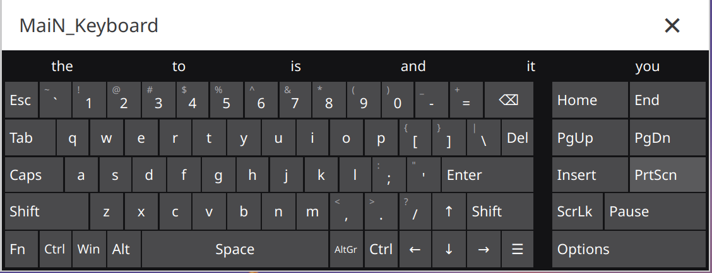

# MaiN_Keyboard

An on-screen keyboard for KDE Plasma / Wayland that actually works.

## Why MaiN_Keyboard?

Many on-screen keyboards have issues under Wayland:
- Focus gets stolen from text fields
- Keystrokes don't arrive
- Complicated configuration required

**MaiN_Keyboard solves these problems** through:
- XWayland mode with special window flags
- Kernel-level keyboard input via uinput
- No focus stealing - text fields stay active

## Closest thing to the Windows On-Screen Keyboard on Linux

MaiN_Keyboard is modelled on the Windows 10/11 On-Screen Keyboard (`osk.exe`), and it is probably the closest match you can get on Linux:

- **Same full layout** - Esc, Fn, Win, Menu, Home/End, Insert, Del, PrtScn, ScrLk, Pause, PgUp/PgDn (US), and the Windows-style arrow cluster with ↑ above ↓ next to right Shift
- **Same keycap look** - flat square keys, the shifted symbol shown small in the corner (`!` above `1`), word keys like Tab and Shift left-aligned
- **Same sticky modifiers** - tap Ctrl, Alt, Win or Shift, then a key, for a shortcut (e.g. Win then E); Fn swaps the number row for F1-F12
- **Same text prediction bar** above the keys, with next-word guessing
- **Options key** under ScrLk and Pause, where Windows puts it
- **Works over most apps and games** - it never takes focus, and keys can still be clicked while a fullscreen game has grabbed the mouse

**Where it falls short of Windows:** some fullscreen games. Windows can draw its keyboard above any game; on Linux some fullscreen games (especially native Wayland ones, or games that take exclusive control of the mouse) may cover the keyboard or keep clicks from reaching it. Windowed and borderless-windowed games are the most reliable.

## Features

- **Works under Wayland** - Uses uinput for reliable keyboard input
- **No focus stealing** - Text fields remain active while typing
- **Windows-style layout** - Full UK and US layouts with a side block of navigation keys and an Options key; UK Enter spans two rows like a real UK keyboard
- **Keycap labels** - Shifted symbols shown in the key corner; labels shrink to fit small keys
- **Fn key** - Turns the number row into F1-F12 until tapped again
- **Sticky Ctrl / Alt / Win** - Tap one, then a key, to send a shortcut
- **Dark design** - Flat square keys with a white title bar; pressed keys turn navy
- **Adjustable opacity** - Set transparency (50%-100%) in Options or the tray menu
- **Multiple layouts** - German (DE), English UK, English US
- **Word suggestions** - Tap a suggestion to finish the word. After a space it guesses the next word from the words you usually type together (text chaining). Words you use often come first; tap **+ word** to add a new one (English list of 20,000 words, small German list)
- **Key repeat** - Hold a key to repeat it, using KDE's repeat settings
- **Knows when you move to another text field** - Suggestions start fresh after a click or touch outside the keyboard. Apps that support accessibility (GTK, Qt/KDE, Firefox) also report the text before the cursor, so suggestions stay right after clicking around, and password fields are never learned from (needs `python-gobject` and `at-spi2-core`)
- **Game support** - Clicks still reach the keyboard when a fullscreen game (e.g. through Wine/Proton) has grabbed the mouse. Some fullscreen games still can't be typed into this way (see above)
- **Options** - **Options** key under ScrLk and Pause (or the tray menu): layout, opacity, number of suggestions, next-word guessing, click/accessibility tracking, forget learned words, remove added words, block words you never want suggested
- **Resizable** - Drag the white-outlined edge or a corner to resize (down to half the default size)
- **System Tray** - Minimizes to taskbar
- **Saves settings** - Remembers size, layout, opacity and suggestion options
- **Movable** - Drag the title bar to move the window

## Screenshot



## Installation

### Arch Linux / CachyOS / Manjaro (AUR)

```bash
paru -S main-keyboard-git   # CachyOS
yay -S main-keyboard-git    # Arch/Manjaro
```

> [!IMPORTANT]
> After installation, add your user to the `input` group and then log out and back in:
> ```bash
> sudo usermod -aG input $USER
> ```

### Manual Installation

**Install dependencies:**
```bash
sudo pacman -S python-pyqt6 python-evdev
```

**Clone repository:**
```bash
git clone https://github.com/cachyOSMaiN/maiN-keyboard.git
cd main-keyboard
```

**Install:**
```bash
sudo make install
```

**Or run directly:**
```bash
python3 main.py
```

### uinput Permission

MaiN_Keyboard requires access to `/dev/uinput`. If needed:

```bash
# Set permission once
sudo setfacl -m u:$USER:rw /dev/uinput

# Or permanently via udev rule
echo 'KERNEL=="uinput", MODE="0666"' | sudo tee /etc/udev/rules.d/99-uinput.rules
sudo udevadm control --reload-rules
sudo udevadm trigger
```

## Usage

| Action | Description |
|--------|-------------|
| **Drag title bar** | Move window |
| **Drag window edge or corner** | Resize keyboard |
| **Options key** (under ScrLk / Pause) | Open options: layout, opacity, suggestions, word lists |
| **Fn** | Toggle F1-F12 on the number row |
| **Ctrl / Alt / Win, then a key** | Send a shortcut |
| **Tap a suggestion** | Finish the word and add a space |
| **+ word** | Add the word you're typing to the suggestions |
| **✕** | Minimize to system tray |
| **Tray icon left-click** | Show/hide keyboard |
| **Tray icon right-click** | Menu with layout, opacity and options |

## Technical Details

- **GUI:** PyQt6
- **Input:** python-evdev (uinput)
- **Display:** XWayland (for focus handling)
- **Config:** `~/.config/osk/settings.json`

## License

MIT License

## Credits

The English word list (`words/en.txt`) comes from [FrequencyWords](https://github.com/hermitdave/FrequencyWords) by Hermit Dave (OpenSubtitles 2018), licensed [CC-BY-SA-4.0](https://creativecommons.org/licenses/by-sa/4.0/). Regenerate it with `python3 tools/build_wordlists.py`.

## Author

MaiN

---

**Keywords:** on-screen keyboard Linux, virtual keyboard KDE Plasma, Wayland on-screen keyboard, OSK Wayland, touchscreen keyboard Linux, software keyboard KDE, on-screen keyboard Python, uinput keyboard Linux, XWayland keyboard, on-screen keyboard Arch Linux, on-screen keyboard CachyOS, on-screen keyboard Manjaro, virtual keyboard Wayland focus, accessibility keyboard KDE
